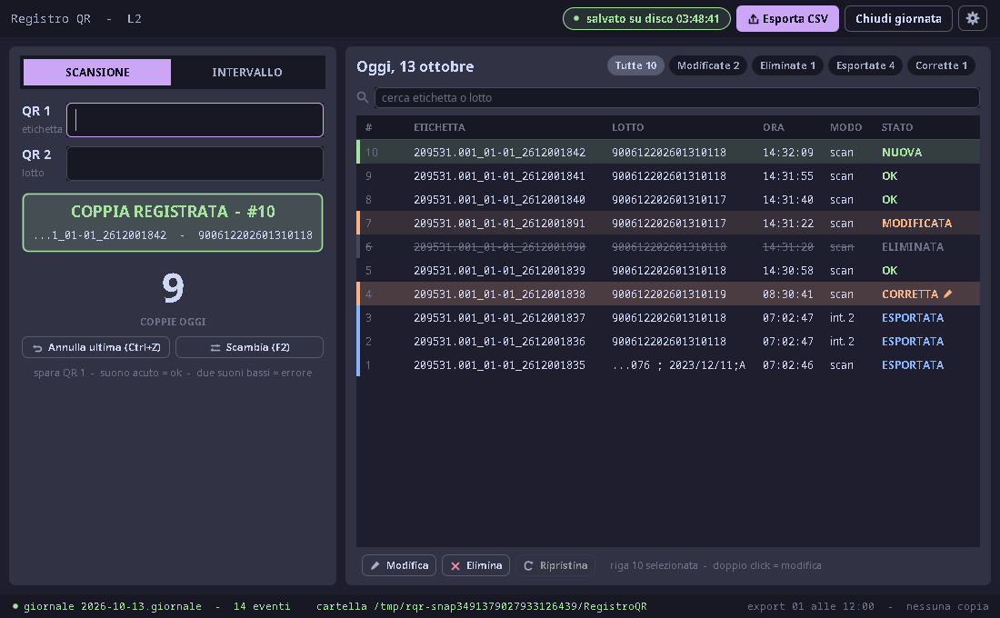
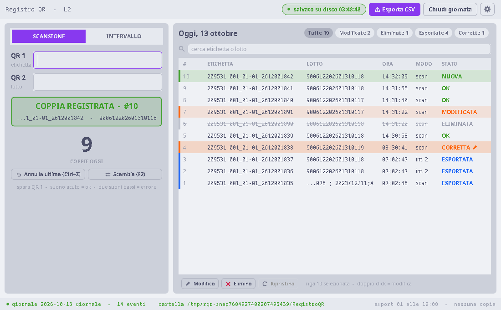

<div align="center">

# ScanLedger

A Java/Swing station program that records label + lot pairs on a production
line without a portal PC, and exports them as CSV files that
[AutoFillSuite](https://github.com/importriri/AutoFillSuite) registers on the
portal.

[](https://github.com/importriri/ScanLedger/actions/workflows/tests.yml)
[](https://github.com/importriri/ScanLedger/actions/workflows/lint.yml)

</div>

## Why it exists

AutoFillSuite registers cable labels on a supplier portal that has no API, from
the PC where the portal is open. A second line has no such PC. ScanLedger
("Registro QR" on screen) runs there: the operator scans a label QR and a lot
QR for every piece, or adds a range, and the program keeps the day's list. When
needed it exports a CSV; AutoFillSuite's **Da file** mode reads that file,
checks it, and registers it on the portal in verified blocks.

It runs on a shop-floor Windows PC as one Java 8 JAR with no runtime
dependencies.

## The data guarantee

- Every pair, range, edit and deletion is written to a day journal and forced
  to disk **before** it shows in the table; there is no Save button and no
  save at exit. `CrashTest` kills a writing JVM 20 times and checks that every
  confirmed pair is on disk.
- A power cut between writing a CSV and recording it is recovered at the next
  start (`ExporterTest`); every export is read back before it counts.
- A lost export is rebuilt from the journal byte for byte, with the
  fingerprint recorded at export time (`RegenerateTest`).

## Workflows

- **Scansione** — QR 1 (label) then QR 2 (lot). Scanners ending with ENTER or
  TAB both work. Swapped codes, unknown shapes and labels already recorded
  today are refused before anything is written.
- **Intervallo** — a first label, a lot and a quantity: one journal event, all
  rows or none, refused whole if it overlaps the day or runs past the moving
  digits.
- **Corrections** — a row never exported can change label and lot. Once
  exported, its label is on the portal and stays; its lot can be corrected and
  goes out in the next export as a `CORREZIONE` (the portal keeps the last
  registration).
- **Export and backup** — incremental files
  `registro_<station>_<day>_<NN>.csv` in an archive that is never overwritten,
  a copy (and the journal) to a USB stick or network folder, retried until it
  succeeds; history, regeneration and full re-export from the settings.

The CSV contract shared with AutoFillSuite is
[`docs/CSV-FORMAT.md`](docs/CSV-FORMAT.md) (in Italian); both repositories test
against the same five sample files.

## Screenshots

| Mocha | Latte |
|---|---|
|  |  |

Synthetic data from the snapshot program (`test/app/ui/Snapshot.java`).

## Project layout

```text
src/app/config/    settings (atomic write) and manual loading
src/app/core/      journal, day model, ranges, CSV writer and reader, exporter
src/app/ui/        station window, table, dialogs, theme, icons, manual renderer
src/app/docs/      Italian and English manuals embedded in the JAR
test/              plain-JDK test programs
test/fixtures/     the five contract samples, identical to AutoFillSuite's
```

The core package does not import the UI package and never touches Swing. More
detail, with the test that pins each rule, is in
[`docs/ARCHITECTURE.md`](docs/ARCHITECTURE.md).

## Build and verify

Requirements: JDK 8 or newer, Ant and Xvfb for the display tests on Linux.

```bash
./verify.sh
java -jar dist/ScanLedger.jar
```

`verify.sh` checks the contract samples, compiles for Java 8 with warnings as
errors, runs the unit, crash and display suites, builds the standalone JAR,
checks its manifest and embedded manuals, and starts the package under Xvfb.

Data lives in `RegistroQR` in the user's home folder by default; settings in
`.registro_qr.properties` next to it.

## Manuals

- [Italiano](src/app/docs/MANUAL.it.md)
- [English](src/app/docs/MANUAL.en.md)
- [Shop-floor test plan](docs/PROVA-IN-REPARTO.md) (Italian)

## License

MIT
